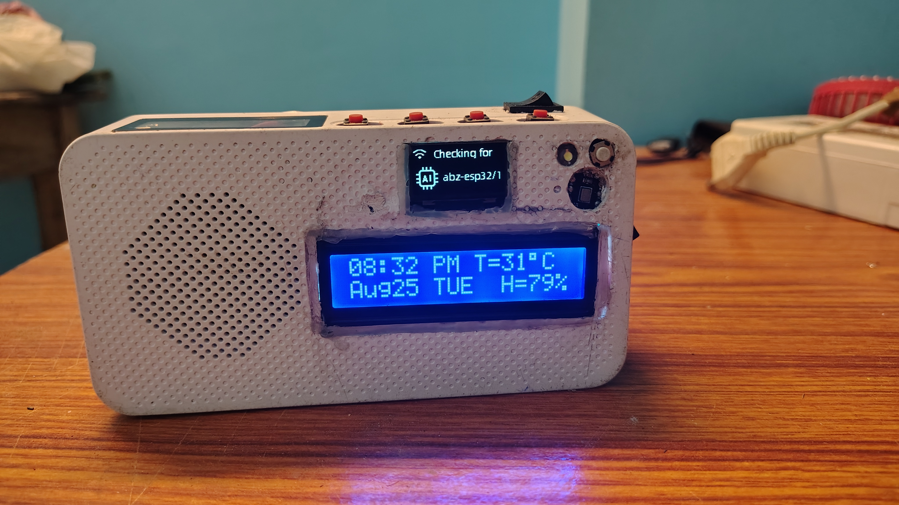
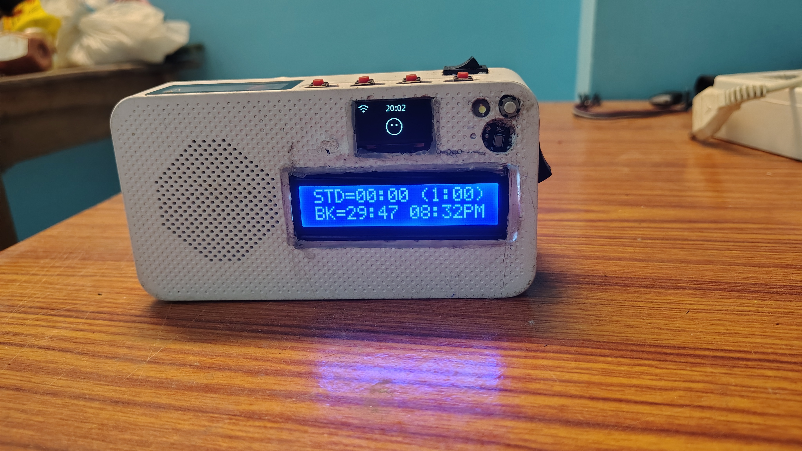
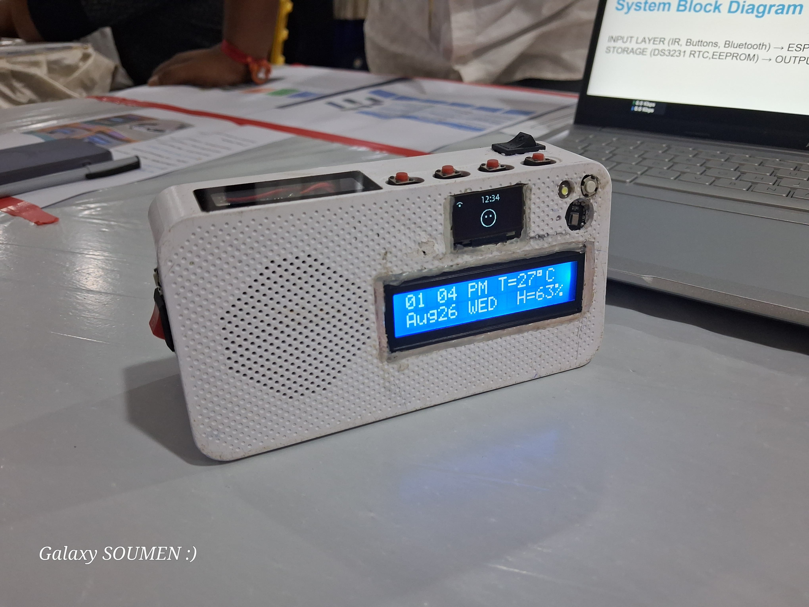
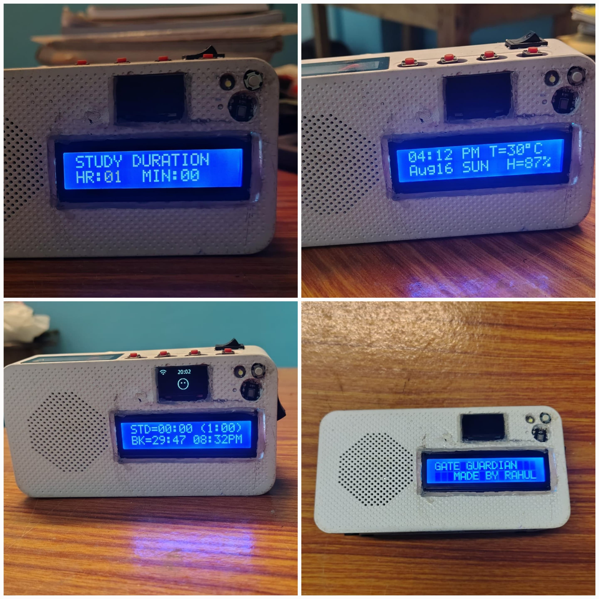
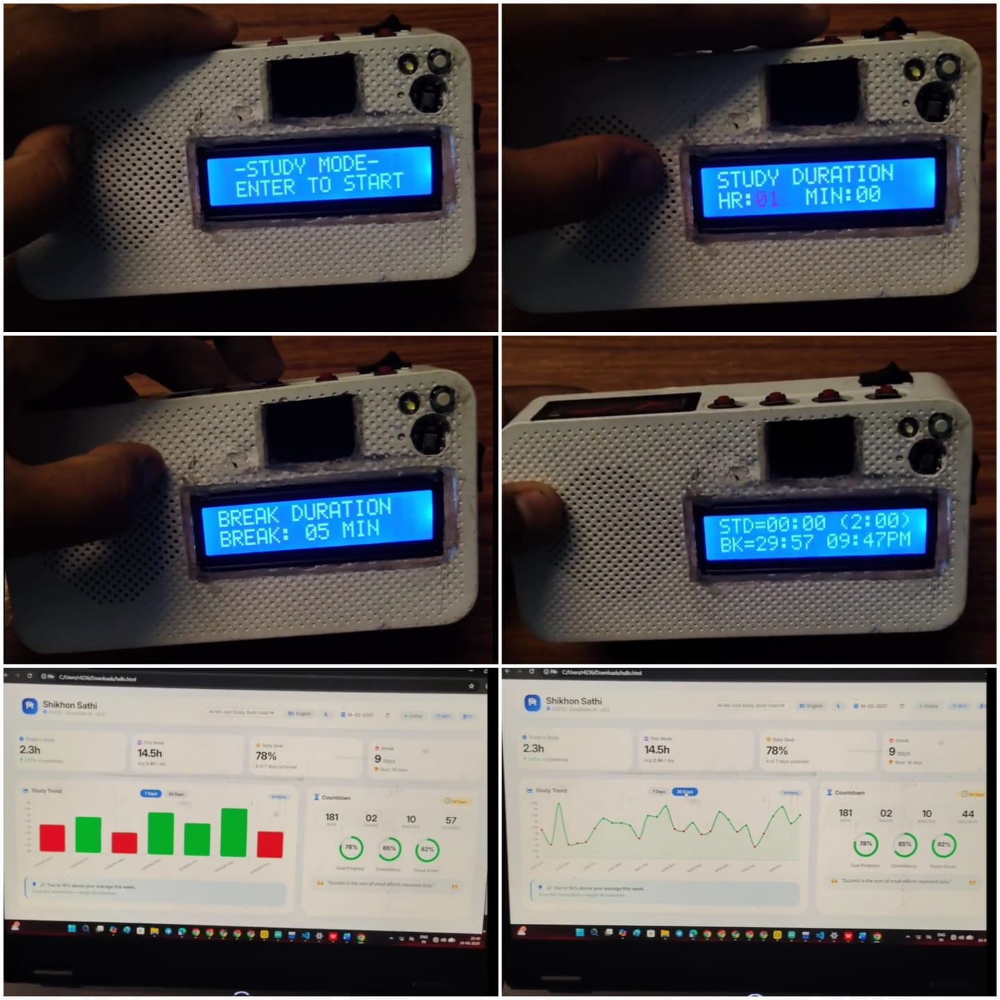
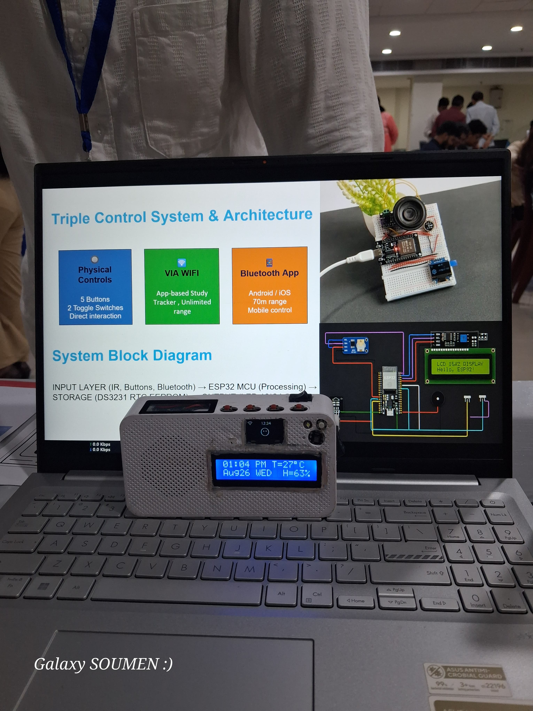
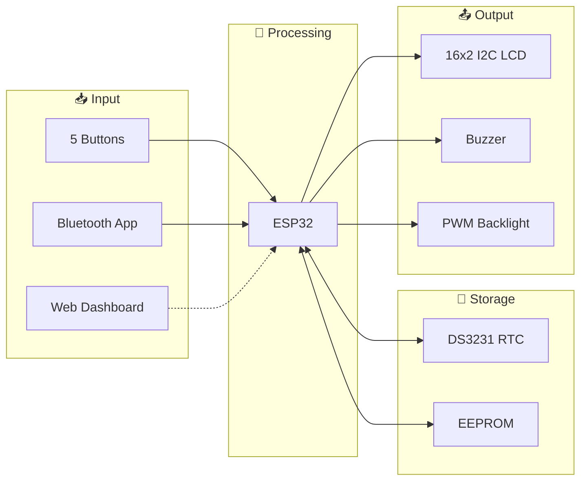
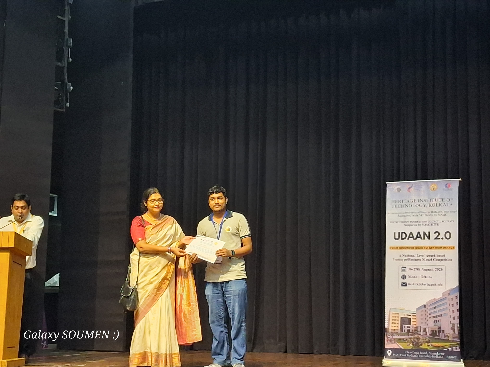

<div align="center">

# ⏰ LCD DeskBuddy

### An ESP32 smart desk clock and study companion — clock, alarm, timer, study sessions and a 350+ line motivation wall on a 16x2 LCD

<br><br>


<br>

[**Overview**](#-overview) ·
[**Gallery**](#-gallery) ·
[**Features**](#-features) ·
[**Architecture**](#-triple-control-architecture) ·
[**Modes**](#-modes) ·
[**Hardware**](#-hardware) ·
[**Bluetooth**](#-bluetooth-commands) ·
[**Dashboard**](#-web-dashboard) ·
[**Install**](#-installation) ·
[**Recognition**](#-recognition-udaan-20) ·
[**Roadmap**](#%EF%B8%8F-roadmap)

</div>

---

## 🚀 Overview

**LCD DeskBuddy** is a standalone desk companion built around an **ESP32**. It is a real-time clock, alarm, countdown timer and a **study-session manager with automatic break reminders**, all on a 16x2 I²C LCD. Between sessions it keeps you going with a rotating wall of short, animated motivation messages.

You can drive it three ways: the **physical buttons** on the case, any **Bluetooth serial app** on your phone, or the companion **web dashboard** for tracking study hours.

> 🏆 **Top 5 finalist at UDAAN 2.0**, a national-level hackathon, out of 500 participants. [See the details](#-recognition-udaan-20).

> 💡 *"Success is an O(1) operation"* — one of the 350+ messages DeskBuddy rotates through.

<div align="center">

| 🎛️ Modes | 💬 Messages | 🎨 Text Styles | 🔘 Buttons | 📡 BT Commands |
|:---:|:---:|:---:|:---:|:---:|
| **6** | **350+** | **6** | **5** | **24** |

</div>

---

## 📸 Gallery

<div align="center">

<table>
  <tr>
    <td align="center" width="33%">
      <br>
      <sub><b>🕐 Clock — time, temperature, humidity, date</b></sub>
    </td>
    <td align="center" width="33%">
      <br>
      <sub><b>📚 Study session running with break countdown</b></sub>
    </td>
    <td align="center" width="33%">
      <br>
      <sub><b>📦 The build — speaker grille, buttons and switch</b></sub>
    </td>
  </tr>
  <tr>
    <td align="center" width="33%">
      <br>
      <sub><b>🖥️ Study setup, clock and splash screen</b></sub>
    </td>
    <td align="center" width="33%">
      <br>
      <sub><b>📊 Study mode setup and the web dashboard</b></sub>
    </td>
    <td align="center" width="33%">
      <br>
      <sub><b>🧩 Triple control system and block diagram</b></sub>
    </td>
  </tr>
</table>

</div>

---

## ✨ Features

| Feature | Description |
|---------|-------------|
| 🕐 **Multi-mode display** | Clock, Clock2 (12-hour with AM/PM), Alarm, Timer, Motivation and Study modes |
| 📚 **Smart study mode** | Set a study duration, break interval and break length, with buzzer reminders |
| 💪 **Motivation wall** | 350+ two-line GATE-flavoured messages with animated text styles |
| ⏰ **Alarm** | Saved in EEPROM, so it survives a power cut |
| ⏱️ **Countdown timer** | Hours / minutes / seconds with pause and resume |
| 🌙 **Auto brightness** | Dimmer backlight at night, full brightness in the day |
| 🔊 **Audio feedback** | Button clicks, tick-tock sound, alarm and timer buzzer |
| 📱 **Bluetooth control** | Full control from any Bluetooth serial terminal |
| 🌡️ **Room climate** | Temperature and humidity from a DHT11 |
| 🔘 **Standalone** | Five buttons run everything with no phone needed |

---

## 🧩 Triple Control Architecture

DeskBuddy can be controlled three independent ways, so it works with or without a phone or network.

<div align="center">

| 🔘 Physical Controls | 🌐 Web Dashboard | 📱 Bluetooth App |
|:---:|:---:|:---:|
| 5 buttons and toggle switches | Study tracker in the browser | Android / iOS serial terminal |
| Direct, no setup | Charts, goals, countdown | Mobile control from a distance |

</div>



<sub>Dotted line: the dashboard in this repo is a front-end prototype (see [Web Dashboard](#-web-dashboard)).</sub>

---

## 🎮 Modes

```
┌─────────────┐     ┌──────────────┐     ┌─────────────┐
│  CLOCK MODE │────▶│  CLOCK2 MODE │────▶│ ALARM MODE  │
└─────────────┘     └──────────────┘     └─────────────┘
       ▲                                        │
       │                                        ▼
┌─────────────┐     ┌──────────────┐     ┌─────────────┐
│ STUDY MODE  │◀────│  MOTIVATION  │◀────│ TIMER MODE  │
└─────────────┘     └──────────────┘     └─────────────┘
```

Press **Mode Select** to move to the next mode.

<details open>
<summary><b>🕐 Clock and Clock2</b></summary>

- **Clock:** time with a blinking colon, temperature (°C), humidity (%) and the date
- **Clock2:** 12-hour format with AM/PM, full date such as `AUG 25 TUE`, plus temperature and humidity

</details>

<details>
<summary><b>⏰ Alarm</b></summary>

- Set the alarm as `HH:MM`
- Stored in EEPROM and restored on boot
- The buzzer keeps sounding until you dismiss it

</details>

<details>
<summary><b>⏱️ Timer</b></summary>

- Configurable hours, minutes and seconds
- Pause and resume
- A `TIME UP!` message with the buzzer when it ends

</details>

<details>
<summary><b>💪 Motivation</b></summary>

- 350+ two-line messages, for example `Focus On Logic` / `Build The Future`
- Animated in six text styles
- Rotates automatically every 25 seconds

</details>

<details open>
<summary><b>📚 Study mode</b></summary>

Pick values with the Increase / Decrease buttons:

| Setting | Options |
|---------|---------|
| **Study hours** | 0 to 9 |
| **Study minutes** | 0, 20, 30, 40 |
| **Break every** | 20, 30, 40, 60, 75, 90 min |
| **Break length** | 2, 5, 10, 15, 30 min |

The screen shows the remaining study time and the countdown to the next break (for example `STD=00:00 (1:00)  BK=29:47  08:32PM`). A buzzer announces each break, and the session keeps running in the background.

</details>

---

## 🔧 Hardware

| Component | Specification |
|-----------|---------------|
| **Microcontroller** | ESP32 (any variant with Bluetooth) |
| **Display** | 16x2 LCD with I²C backpack (address `0x27`) |
| **RTC** | DS3231 (I²C) with coin cell |
| **Sensor** | DHT11 temperature and humidity |
| **Backlight control** | PWM on GPIO 5 |
| **Buzzer** | Passive buzzer on GPIO 12 |
| **Inputs** | 5 tactile buttons plus toggle switches |

### Pin map

| Function | GPIO | Notes |
|----------|:----:|-------|
| I²C SDA | 21 | LCD and RTC share the bus |
| I²C SCL | 22 | LCD and RTC share the bus |
| DHT11 data | 4 | Temperature / humidity |
| LCD backlight (PWM) | 5 | 5 kHz PWM |
| Buzzer | 12 | Passive buzzer |
| **Mode Select** | 32 | Cycle through modes |
| **Set / Confirm** | 33 | Enter settings, confirm |
| **Increase** | 25 | Increment a value |
| **Decrease** | 26 | Decrement a value |
| **Discard** | 27 | Cancel; long press opens Quick Settings |

---

## 🔘 Controls

| Button | Press | Action |
|--------|-------|--------|
| **Mode Select** | Short | Next mode |
| **Set / Confirm** | Short | Enter settings or confirm |
| **Increase / Decrease** | Short | Change the selected value |
| **Discard** | Short | Cancel, clear alarm, stop study |
| **Discard** | Long (1 s) | Quick Settings: brightness and buzzer on/off |

| Mode | Set button | Discard button |
|------|------------|----------------|
| **Alarm** | Enter alarm setup | Disable alarm |
| **Timer** | Enter timer setup | Stop timer |
| **Motivation** | — | Back to clock |
| **Study** | Configure / start | Stop session |

---

## 📡 Bluetooth Commands

Pair with the device named **`ESP32_Clock`** and send commands from any Bluetooth serial terminal app.

<details open>
<summary><b>⚙️ Basic</b></summary>

| Command | Action |
|---------|--------|
| `home` | Return to the clock |
| `offme` | System off (backlight off) |
| `onme` | System on |
| `buzzeron` / `buzzeroff` | Enable / disable the buzzer |

</details>

<details>
<summary><b>💡 Display and brightness</b></summary>

| Command | Action |
|---------|--------|
| `bright(0-1000)` | Set brightness |
| `speed(1-1000)` | Animation speed |
| `nightbright(0-1000)` | Night brightness |
| `daybright(0-1000)` | Day brightness |
| `nightstart(0-23)` | Hour night mode starts |
| `morningend(0-23)` | Hour night mode ends |
| `autobright on/off` | Toggle auto brightness |

</details>

<details>
<summary><b>🔊 Audio</b></summary>

| Command | Action |
|---------|--------|
| `tickfreq(freq)` / `tockfreq(freq)` | Tick and tock pitch |
| `tickdur(ms)` / `tockdur(ms)` | Tick and tock length |

</details>

<details>
<summary><b>💬 Messages</b></summary>

| Command | Action |
|---------|--------|
| `mv(style)` | Start motivation mode (styles 2, 4, 5, 6) |
| `text(style)Line one@Line two` | Show a custom message, `@` splits the two lines |
| `Any plain text` | Show it centered |

| Style | Effect |
|:-----:|--------|
| 1 | Left-aligned, static |
| 2 | Centered, static |
| 3 | Scrolling marquee |
| 4 | Blinking, centered |
| 5 | Typewriter |
| 6 | Character-by-character reveal |

</details>

<details>
<summary><b>🕒 Time, alarm and timer</b></summary>

| Command | Action |
|---------|--------|
| `SET:HH,MM,SS,DD,MM,YYYY` | Set the RTC |
| `setalarm:HH,MM,SS` | Set the alarm |
| `alarmon` / `alarmoff` | Enable / disable the alarm |
| `settimer:HH,MM,SS` | Set the timer |
| `timerstop` | Stop the timer |

</details>

---

## 🌐 Web Dashboard

`study_web.html` is a companion study-tracker dashboard, a single file you can open in any browser.

- 🌍 **Bilingual:** switch between বাংলা and English
- 🌗 **Light and dark theme**
- 📈 **Study trend chart** for the last 7 or 30 days (Chart.js)
- 🎯 **KPI cards:** today's study time, weekly total, daily goal and streak
- ⏳ **Exam countdown:** pick your exam date and watch days, hours, minutes and seconds
- 🔵 **Progress rings:** goal progress, consistency and focus score
- 💬 **Motivation strip** with a rotating quote

<div align="center">

</div>

> ℹ️ The dashboard currently runs on **sample data**. The firmware in this repo talks over buttons and Bluetooth; wiring live device data into the dashboard is on the [roadmap](#%EF%B8%8F-roadmap). Fonts, icons and Chart.js load from a CDN, so you need an internet connection when you open it.

---

## 🚀 Installation

### 1. Set up Arduino IDE

1. Install the **Arduino IDE** (or PlatformIO)
2. Add the **ESP32 board package** (Boards Manager)
3. Install these libraries from **Sketch → Include Library → Manage Libraries**:

| Library | Author |
|---------|--------|
| `LiquidCrystal I2C` | Frank de Brabander |
| `RTClib` | Adafruit |
| `DHT sensor library` | Adafruit |

`Wire`, `BluetoothSerial` and `EEPROM` come with the ESP32 package.

### 2. Upload

```bash
git clone https://github.com/rahul-the-phoenix/LCD_DeskBuddy.git
cd LCD_DeskBuddy
```

1. Open `advanced.ino` in Arduino IDE
2. Select your ESP32 board and port
3. Click **Upload**
4. On boot the splash screen shows, then the clock starts

### 3. Set the time

Connect over Bluetooth and send, for example:

```
SET:20,30,00,25,08,2026
```

### Tweak the defaults

```cpp
int  nightBrightness = 300;   // night backlight (0-1000)
int  dayBrightness   = 1000;  // day backlight (0-1000)
int  nightStartHour  = 21;    // night mode starts at 9 PM
int  morningEndHour  = 6;     // night mode ends at 6 AM
int  brightnessLevel = 500;   // starting brightness
bool buzzerEnabled   = true;  // buzzer on at boot
```

---

## 📂 Project Structure

```
LCD_DeskBuddy/
├── advanced.ino       # Main firmware sketch
├── main_project.ino   # Working copy of the sketch (extra dev notes, a few more messages)
├── study_web.html     # Companion study dashboard
├── assets/            # Photos of the build and the UDAAN 2.0 showcase
├── LICENSE            # MIT
└── README.md
```

---

## 📊 Technical Notes

| Parameter | Value |
|-----------|-------|
| **Power** | 5 V over USB |
| **Backlight PWM** | 5 kHz, brightness 0-1000 mapped to PWM |
| **Alarm storage** | 8 bytes of EEPROM, validated with a magic byte (`0xA5`) |
| **Button debounce** | 200 ms (120 ms for Increase / Decrease) |
| **Long press** | 1 second |
| **Bluetooth name** | `ESP32_Clock` |

---

## 🐛 Troubleshooting

| Issue | Try this |
|-------|----------|
| LCD stays blank | Run an I²C scanner, check the `0x27` address and wiring, adjust the contrast pot |
| Wrong time after power-up | Check the RTC coin cell, then set the time with `SET:` |
| DHT11 reads fail | Check the data pin (GPIO 4) and add a pull-up resistor |
| Bluetooth not found | Reset the ESP32 and look for `ESP32_Clock` |
| Buttons do nothing | Check wiring and pull-ups on GPIO 32, 33, 25, 26, 27 |
| Alarm not saved | Make sure EEPROM is initialised (magic byte `0xA5`) |

---

## 🏆 Recognition: UDAAN 2.0

<div align="center">

### 🥇 Top 5 Finalist — among 500 participants

**UDAAN 2.0: From Grounded Ideas to Sky High Impact**<br>
*A national-level, reward-based hackathon*

</div>

LCD DeskBuddy was shortlisted as one of the **top 5 finalist projects** at UDAAN 2.0, organised by the **Institution's Innovation Council (IIC), Heritage Institute of Technology, Kolkata**.

| | |
|---|---|
| 🎯 **Event** | UDAAN 2.0 — National-Level Reward Based Competition |
| 🏛️ **Organiser** | Institution's Innovation Council (IIC), Heritage Institute of Technology, Kolkata |
| 📅 **Dates** | 26-27 August 2026 |
| 👥 **Field** | 500 participants |
| 🏁 **Result** | Top 5 finalist |
| 🔧 **Project** | LCD DeskBuddy — ESP32 smart desk clock and study companion |

### 🧭 How the competition ran

```
Registration ─▶ Round 1 ─▶ Finalists declared ─▶ Final round ─▶ Award ceremony
                 │                                     │
        External industry jury              External industry experts
```

1. **Round 1:** every team was evaluated by an external jury of industry members
2. **Finalists declared:** DeskBuddy cleared the cut and made the top 5
3. **Final round:** the finalists were judged by external industry experts, followed by the award ceremony on Day 2

### 🛠️ What was presented

DeskBuddy was presented as a working prototype together with its **triple control architecture** (physical controls, Bluetooth app and web dashboard) and the system block diagram, covering the study-session engine, EEPROM-backed alarm and the companion study dashboard.

<div align="center">

<table>
  <tr>
    <td align="center" width="50%">
      <br>
      <sub><b>🎤 On stage at UDAAN 2.0</b></sub>
    </td>
    <td align="center" width="50%">
      <br>
      <sub><b>🏅 UDAAN 2.0 certificate</b></sub>
    </td>
  </tr>
</table>

</div>

---

## 🗺️ Roadmap

- [ ] Pomodoro mode
- [ ] Study statistics and progress tracking
- [ ] Subject-wise study tracking
- [ ] Export study data over Bluetooth
- [ ] Live Wi-Fi sync between the device and the dashboard
- [ ] Battery level monitoring
- [ ] RGB status LEDs

---

## 🤝 Contributing

Ideas and pull requests are welcome.

1. 🍴 Fork the repository
2. 🌿 Create a branch: `git checkout -b feature/my-feature`
3. 💾 Commit your changes
4. 📬 Open a pull request

---

## 📄 License

Released under the **MIT License**. See [`LICENSE`](LICENSE) for details.

Copyright © 2026 Rahul Manna

---

## 👨‍💻 Author

**Rahul Manna**

[](https://github.com/rahul-the-phoenix)

---

<div align="center">

### Built with ☕, solder and ❤️ by Rahul Manna

[🐞 Report Bug](https://github.com/rahul-the-phoenix/LCD_DeskBuddy/issues) · [✨ Request Feature](https://github.com/rahul-the-phoenix/LCD_DeskBuddy/issues)

⭐ *If DeskBuddy helped you focus, drop a star!* ⭐

</div>
